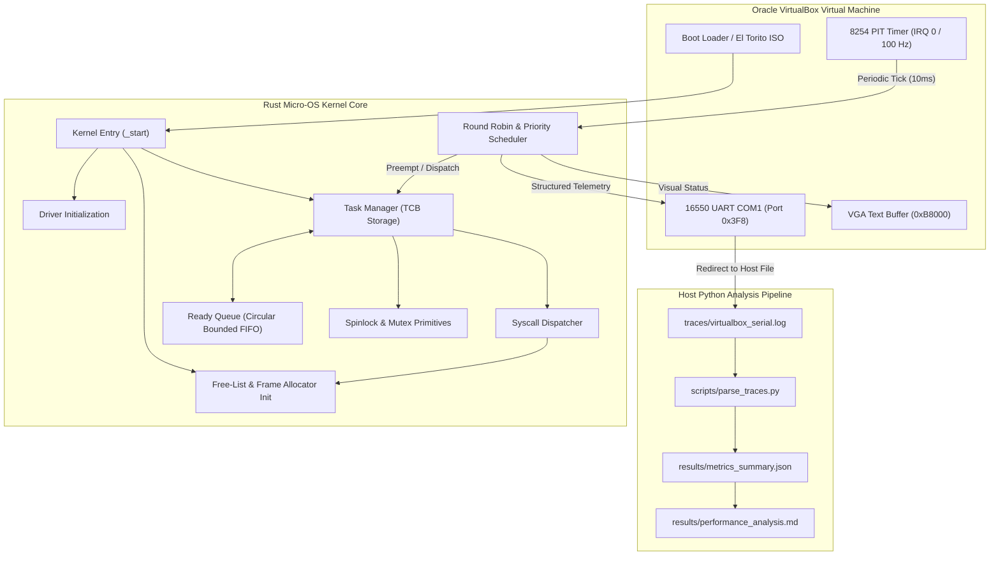

# CA-6 Micro-OS System Architecture

## 1. System Overview

The **Rust Micro-OS** is an educational, mechanism-visible operating system engineered for x86_64 virtualization platforms, specifically targeting **Oracle VirtualBox**. Rather than constructing a monolithic, opaque kernel, the Micro-OS decomposes fundamental operating-system mechanisms into modular, measurable abstractions.

```text
+-------------------------------------------------------------------------+
|                  Integrated Test Suite & User Applications              |
|          (TC1: Minimum, TC2: Multi, TC3: Boundary, TC4: Stress, ...)    |
+-------------------------------------------------------------------------+
|                    Layer 9: System Call Interface                       |
|           [SYS_YIELD | SYS_SLEEP | SYS_MALLOC | SYS_FREE | SYS_EXIT]    |
+-------------------------------------------------------------------------+
|             Layer 3, 4, 5: Task Management & CPU Scheduling             |
|   +-----------------------+   +-------------------------------------+   |
|   |  Task Control Block   |   |        Round Robin Scheduler        |   |
|   |  (TCB, Context, Stack)|   |        (Fixed Quantum Q=3)          |   |
|   +-----------------------+   +-------------------------------------+   |
|   |      Ready Queue      |   |   Specialization Track A: Priority  |   |
|   |  (Circular Bounded)   |   |   Scheduler with Dynamic Aging      |   |
|   +-----------------------+   +-------------------------------------+   |
+-------------------------------------------------------------------------+
|                Layer 7: Synchronization Subsystem                       |
|         [KernelSpinlock<T> with Contention & Deadlock Telemetry]        |
|         [KernelMutex with Cooperative Blocked Wait Queue]               |
+-------------------------------------------------------------------------+
|                 Layer 8: Memory Management Subsystem                    |
|   +---------------------------------+ +-------------------------------+ |
|   |   Frame Allocator (4 KiB Bitmap)| | Bump Allocator (Linear Boot)  | |
|   +---------------------------------+ +-------------------------------+ |
|   | Free-List Allocator (First-Fit, Splitting, Coalescing, Telemetry) | |
+-------------------------------------------------------------------------+
|                 Layer 6: Timer & Interrupt Subsystem                    |
|             [8254 PIT (100 Hz = 10ms tick) | Monotonic Tick]            |
+-------------------------------------------------------------------------+
|              Layer 2: Diagnostic & Logging Subsystem                    |
|       [KernelLogger: Severity, Subsystem Tags, Millisecond Ticks]       |
+-------------------------------------------------------------------------+
|                     Layer 1: Hardware Drivers                           |
|       [16550 UART COM1 (Port 0x3F8)]   [VGA Text Buffer (0xB8000)]      |
+-------------------------------------------------------------------------+
|                     Virtualization Layer (Hardware)                     |
|                 Oracle VirtualBox x86_64 Virtual Machine                |
|      - COM1 redirected to host file: `traces/virtualbox_serial.log`     |
|      - Display attached to 80x25 text console                           |
+-------------------------------------------------------------------------+
```

---

## 2. Mermaid Control & Data Flow Diagram



---

## 3. Subsystem Interconnects

### 3.1 Boot and Driver Interconnect
Upon execution, `_start` invokes `drivers::init()`. The UART driver establishes the 16550 baud rate divisor, turns off interrupts, and clears the FIFO. In Oracle VirtualBox, COM1 is bound directly to a host raw file, transforming all kernel serial writes into permanent traces. Concurrently, the VGA driver sets up the 80x25 color matrix at address `0xB8000` to mirror diagnostic output on the VM window.

### 3.2 Timer and Scheduler Interconnect
The 8254 PIT generates ticks every 10 ms (100 Hz). On every tick:
1. `KERNEL_TICKS` monotonically increments.
2. The active scheduler decrements `remaining_ticks` and increments `current_quantum_ticks`.
3. If the quantum expires ($Q=3$), the scheduler preempts the active task, updates its `TaskControlBlock` state to `Ready`, pushes it to the tail of `ReadyQueue`, dequeues the next runnable task, and updates state to `Running`.

### 3.3 Memory and System Call Interconnect
Applications issue requests through `SyscallDispatcher::dispatch()`. `SYS_MALLOC` requests are routed to the `FreeListAllocator`. The allocator inspects block headers, selects a block via First-Fit, splits excess capacity, and returns the aligned payload address. On `SYS_FREE`, the allocator flags the header as free and triggers an immediate neighbor coalescing pass to prevent external fragmentation.
